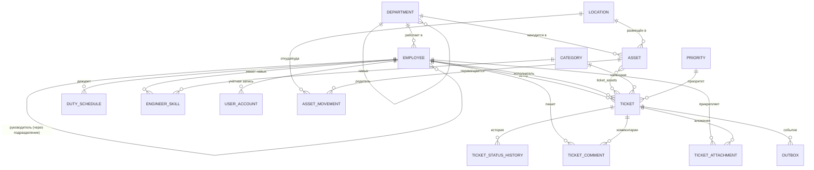

# Модели данных Service Desk (п. 4.1 ТЗ)

## 1. Концептуальная модель (ER-диаграмма)

**Сущности (18+ таблиц):**

| Схема | Таблицы |
|---|---|
| `ref` | `departments`, `employees`, `locations`, `categories`, `priorities_sla`, `engineer_skills`, `duty_schedule`, `production_calendar`, `ticket_transitions`, `ticket_status` |
| `core` | `tickets`, `ticket_status_history`, `ticket_comments`, `ticket_attachments`, `ticket_assets`, `assets`, `asset_movements`, `outbox` |
| `audit` | `log` (секционирована по месяцам), `ddl_log`, `security_events` |
| `sec` | `users`, `roles`, `user_roles` |
| `stage` | `import_log` |

## 2. Логическая модель (ключевые сущности)

- **`ref.departments`** (`department_id PK`, `parent_id FK self`, `name`, `code UNIQUE`, `head_employee_id FK → employees`, …) — иерархия подразделений.
- **`core.tickets`** (`ticket_id PK`, `ticket_number UNIQUE`, `author_id FK → employees`, `executor_id FK → employees`, `category_id FK → categories`, `priority FK → priorities_sla`, `status`, `subject`, `description`, `description_tsv` GENERATED, `created_at`, `updated_at`, `version`, `sla_deadline`, `sla_spent_min`, `sla_paused_at`, `sla_paused_total`, `closed_at`, `is_deleted`).
- **`core.ticket_status_history`** (`history_id PK`, `ticket_id FK`, `from_status`, `to_status`, `changed_at`, `changed_by FK`, `comment`).
- **`core.assets`** (`asset_id PK`, `inv_no UNIQUE`, `serial_no UNIQUE`, `name`, `category_id FK`, `location_id FK`, `is_active`).
- **`core.asset_movements`** (`movement_id PK`, `asset_id FK`, `from_location FK`, `to_location FK`, `moved_at`, `movement_type`).
- **`core.outbox`** (`outbox_id PK`, `aggregate_type`, `aggregate_id`, `event_type`, `payload jsonb`, `created_at`, `processed_at`, `attempts`, `last_error`).

Полное описание колонок и ограничений — в `db/init/03_tables_ref.sql`, `04_tables_core.sql`, `05_tables_audit.sql`, `06_tables_sec.sql`, `07_tables_stage.sql`.

## 3. Физическая модель

- **Схемы** изолируют домены: `ref` (справочники), `core` (предметная область), `audit` (журналы), `sec` (безопасность), `stage` (импорт).
- **Пользовательские домены:** `email` на базе `citext` с проверкой формата; `snils` с контрольной суммой (функция `ref.calc_snils_check`); `inv_no`.
- **`audit.log` секционирована по месяцам** (`PARTITION BY RANGE (changed_at)`) — чтобы архивация старых журналов не блокировала работу.
- **Изоляция параллельных запросов:** `shm_size: 256mb` в `docker-compose.yml` (по умолчанию 64 МБ недостаточно для больших таблиц).
- **Индексы** — см. `db/init/10_indexes.sql` (только те, что дали измеримый выигрыш по `EXPLAIN`).
- **Защита от пересечений дежурств:** `EXCLUDE USING gist (engineer_id WITH =, tstzrange(shift_start, shift_end) WITH &&)` — границы `[)` (см. п. 4.1 ТЗ).
- **Частичный уникальный индекс:** один СНИЛС — не более одного действующего сотрудника (`WHERE dismissal_date IS NULL`).

## 4. Нормализация до 3НФ

Проверка по таблицам предметной области:

| Таблица | 1НФ | 2НФ | 3НФ | Комментарий |
|---|---|---|---|---|
| `ref.departments` | атомарные поля | PK `department_id` | `head_employee_id` не зависит от `parent_id` | иерархия через `parent_id` |
| `ref.employees` | атомарные поля | PK `employee_id` | `department_id` → `departments`; ФИО не зависят от должности | СНИЛС вынесен в домен |
| `core.tickets` | атомарные поля | PK `ticket_id` | `executor_id`, `category_id`, `priority` → справочники | `description_tsv` — вычисляемое поле (не нарушает 3НФ, т.к. функционально зависит только от `description`) |
| `core.ticket_status_history` | атомарные поля | PK `history_id` | все атрибуты зависят от `history_id` | append-only |
| `core.assets` | атомарные поля | PK `asset_id` | `location_id` → `locations`, `category_id` → `categories` | |
| `core.asset_movements` | атомарные поля | PK `movement_id` | `from_location`, `to_location` → `locations` | |
| `core.outbox` | атомарные поля | PK `outbox_id` | `payload` зависит от `outbox_id` | |

**Вывод:** схема приведена к **3НФ**. Транзитивных зависимостей нет: каждый неключевой атрибут зависит только от первичного ключа своей таблицы.

## 5. Обоснованные денормализации

| Поле | Таблица | Почему денормализовано |
|---|---|---|
| `core.tickets.description_tsv` (`tsvector`, GENERATED ALWAYS) | `core.tickets` | Полнотекстовый индекс требует `tsvector`; пересчёт при каждом чтении слишком дорог (GIN-индекс хранится отдельно, 13 МБ). |
| `core.tickets.sla_spent_min` | `core.tickets` | Вычисляется триггером при закрытии заявки; хранение избавляет от пересчёта `working_minutes()` при каждом отчёте. |
| `core.tickets.sla_paused_total` | `core.tickets` | Агрегат пауз, накапливается триггером; иначе пришлось бы суммировать историю статусов при каждом чтении. |
| `core.tickets.version` | `core.tickets` | Оптимистичная блокировка для конкурентного обновления (`UPDATE ... WHERE version = :v`). |
| `ref.employees.legacy_name` / `ref.categories.legacy_name` | справочники | Сохранение исходного написания из легаси-системы для сверки (п. 3.7 ТЗ). |
| `ref.priorities_sla.description` | `ref.priorities_sla` | Реакционные нормы (0.5/1/3/9 ч) хранятся только в тексте описания — отдельная колонка `reaction_hours` не добавлялась, т.к. реакционное время считается в `analysis/sla.py`, а не в БД. |

## 6. Связь с требованиями ТЗ

- Не менее **18 таблиц** в схемах `ref`/`core`/`audit`/`sec`/`stage` — реализовано **21 базовая таблица** + секции `audit.log`.
- PK, FK с осознанно выбранными `ON DELETE`/`ON UPDATE`, `UNIQUE`, `CHECK`, `NOT NULL` — см. `db/init/03_tables_ref.sql` … `07_tables_stage.sql`.
- Пользовательские домены `email`, `snils`, `inv_no` — `db/init/02_domains.sql`.
- `EXCLUDE USING gist` по `tstzrange` для графика дежурств — `ref.duty_schedule`.
- Частичный уникальный индекс по СНИЛС — `uq_employees_snils_active`.
